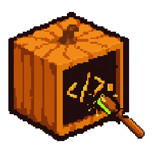

<p align="center">
  
</p>

# Carve

Skript-style scripts for Pumpkin, the Minecraft server written in Rust.

**[Documentation](https://lunakyun.github.io/carve/)** · [Syntax reference](https://lunakyun.github.io/carve/reference/)

[](https://github.com/lunakyun/carve/actions/workflows/ci.yml)
[](#license)
[](https://github.com/Pumpkin-MC/Pumpkin)

> [!WARNING]
> Some of Carve's code was written with the help of AI. It is held to the same bar as the
> rest: every feature has automated tests, CI checks formatting and builds, the engine is
> benchmarked for speed, and the core features are tested in-game on a real Pumpkin server.
> Found a bug? [Open an issue](https://github.com/lunakyun/carve/issues).

Carve is a scripting plugin for [Pumpkin](https://github.com/Pumpkin-MC/Pumpkin),
in the spirit of Skript. You write what should happen in near-plain English,
save the file and reload. No Rust, no compiling.

```
on join:
    add 1 to {joins::%player%}
    if {joins::%player%} is 1:
        broadcast "&eSay hi to %player%, they are new!"
    else:
        send title "Welcome back!" to player

command /heal [<player>]:
    permission: heal
    trigger:
        heal player
```

## Features

- **Events:** about 150 triggers: join, quit, chat, break, place, death,
  damage (with `attacker`), clicks (`on right click with blaze rod on barrel:`),
  inventories, items, movement, vehicles, weather, worlds, `on load`,
  `every 5 seconds` and `at 18:00`. Most can be cancelled.
- **Commands** with typed arguments (`<text>`, `<number>`, `<player>`),
  optional arguments, permissions, aliases and usage messages.
- **Loops:** `loop N times`, `loop {list::*}`, `loop all players`, `while`,
  with `exit loop` and `continue`.
- **Conditions** with `and`, `or` and brackets, `is "a" or "b"`, text checks
  (`contains`, `starts with`), ranges and inventory checks.
- **Functions** with typed parameters, defaults and return values, callable
  from every script. **Options** with `{@name}`.
- **Types:** numbers, text, players, items (`2 diamonds`), locations,
  worlds, dates and time spans, colors, vectors and more, all saved in
  `carve.redb`.
- **The world:** blocks, entities, particles, sounds, potion effects,
  weather and time, game rules, scoreboards, boss bars, chest menus, item
  names and lore.
- **SkBee-style extras:** bounds, text components, NBT, display entities,
  ray traces, recipes, advancements and teams.
- **`wait`** in ticks or seconds, without blocking the server, also inside
  loops and functions.
- **Clear errors** with file, line and "did you mean" suggestions.
- **Skript-style loading:** a broken line or trigger is reported and skipped; the rest of the script still loads.
- **Fast:** players are looked up once per run, and constants are worked out
  at load time. See [performance](docs/performance.md).

## Quick install

1. Download `carve.wasm` from a release, or build it (below).
2. Put it in your server's `plugins/` folder and start the server.
   Allow the `fs.read.data` and `fs.write.data` permissions when asked.
   On a hosted server without an interactive console, allow them in
   `pumpkin.toml` instead (see below).
3. Put `*.carve` files in `plugins/data/carve/scripts/`.
4. Run `/carve reload` (ops can by default). `/carve help` lists everything
   else: enable/disable, info, errors, variables, run and timings.

On hosted servers (panels without a console you can type in), Pumpkin can't
ask and skips Carve with "Console readline is not available". Allow the
permissions in `pumpkin.toml`:

```toml
[plugins.overrides.carve]
allowed_permissions = ["fs.read.data", "fs.write.data"]
```

Write them with dots exactly like this. Pumpkin compares the text exactly,
and the `fs:read:data` form shown in Pumpkin's own config comment doesn't
match.

The full walkthrough is in [getting started](docs/getting-started.md).

### Build from source

```
rustup target add wasm32-wasip2
cargo build -p carve-wasm --release --target wasm32-wasip2
# -> target/wasm32-wasip2/release/carve.wasm
```

## Documentation

- [Getting started](docs/getting-started.md)
- Syntax: [triggers](docs/syntax/triggers.md), [effects](docs/syntax/effects.md),
  [conditions](docs/syntax/conditions.md), [expressions](docs/syntax/expressions.md),
  [loops](docs/syntax/loops.md), [functions and options](docs/syntax/functions.md),
  [types](docs/syntax/types.md)
- [Placeholders](docs/placeholders.md)
- [Variables](docs/variables.md)
- [Commands](docs/commands.md)
- [The /carve command](docs/admin.md)
- [Reading errors](docs/errors.md)
- [Known limits](docs/limits.md)
- [Architecture](docs/architecture.md)
- [Performance](docs/performance.md)
- [In-game testing](docs/ingame-testing.md)
- [Examples](examples/): economy, starter kit, chat filter, join counter, heal, welcome

## FAQ

**Is it Skript compatible?**
No. Carve looks a lot like Skript, but it is its own language with far fewer
features. Most Skript scripts will not load without changes.

**Why does my new command need a restart?**
Pumpkin lets a plugin register commands only while the plugin loads, and it
has no way to remove them. `/carve reload` updates the code of commands that
already exist. New commands show up after a restart. See
[commands](docs/commands.md#reloading-and-restarting).

**My permission doesn't work, even for ops.**
Pumpkin denies permission nodes that were never registered. Carve registers
the `carve:` nodes used in commands when it loads, so a node added later needs
a restart. See [permissions](docs/commands.md#permissions).

**Does a broken script crash the server?**
No. Load errors skip only the broken line, section or trigger, like Skript.
Runtime errors stop only that run and are logged with the file and line.

## Roadmap

Planned, not available yet:

- the rest of the Skript syntax that Pumpkin's plugin API allows (see the
  ⬜ rows in the checklist)
- adding new commands on reload, once Pumpkin's API allows it
- the ⛔ rows, as Pumpkin adds the events and APIs they need

The full list of every core Skript feature and where Carve stands is in the
[Skript parity checklist](docs/skript-parity.md).

Ideas and votes are welcome in the issues.

## Contributing

Bug reports, ideas and pull requests are welcome. See
[CONTRIBUTING.md](CONTRIBUTING.md) for how to build, test and add new syntax.
Changes are listed in [CHANGELOG.md](CHANGELOG.md).

## License

Carve is dual-licensed under [MIT](LICENSE-MIT) or [Apache-2.0](LICENSE-APACHE),
at your option.
