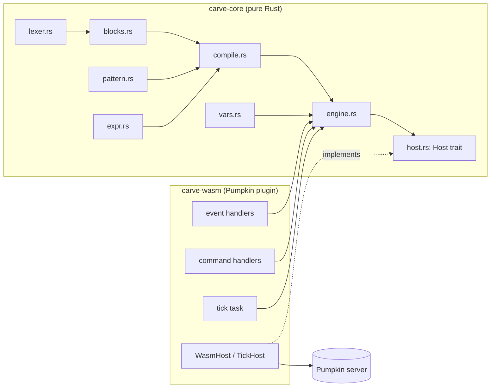
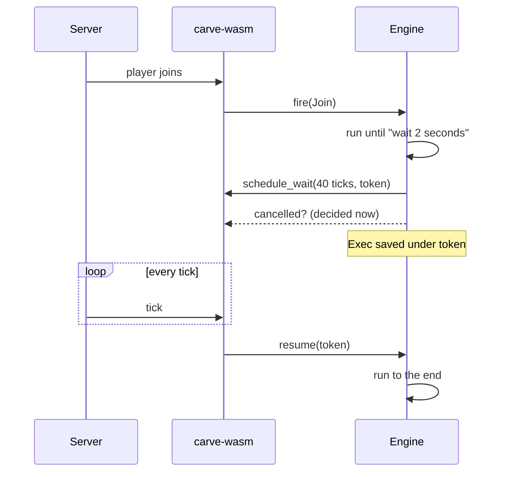

# Architecture

Read this if you want to work on Carve itself.

## Two crates



- **`crates/carve-core`** is the language. It has no Pumpkin dependency and no
  game code. It reaches the game only through the `Host` trait in `host.rs`:
  send a message, heal a player, look up a player, schedule a wait, and so on.
  The tests use a mock host, so the whole language can be tested with
  `cargo test` and no server.
- **`crates/carve-wasm`** is the Pumpkin plugin, built on `pumpkin-plugin-api`
  (WIT v0.1). It loads scripts from disk, registers commands and event
  handlers, and implements `Host` with real Pumpkin calls.

Keeping the core free of Pumpkin means the language doesn't break when the
plugin API changes, and any other host could run Carve too.

## From text to instructions

1. **`blocks.rs`** turns the file into a tree of lines by indentation, and
   strips `#` comments.
2. **`lexer.rs`** turns one line into tokens: words, numbers, `"text"`,
   `{variables}` and symbols.
3. **`compile.rs`** matches each line against the pattern lists
   (`EFFECT_PATTERNS`, `CONDITION_PATTERNS`). The first pattern that matches
   wins, so more specific patterns come first.
4. **`pattern.rs`** does the matching. A pattern string like
   `send %text% [to %player%]` is expanded into plain sequences, one per
   choice of optional parts, and matched with backtracking. Each value slot
   tries growing spans of tokens and asks `expr.rs` to parse them. Parse
   results are cached per span for the whole line.
5. **`expr.rs`** parses values: math, templates, variables, `player`, and so
   on. It folds constants (`2 * 3` becomes `6`) and works out variable names
   that have no `%...%` in them.

Each trigger compiles to a flat list of instructions:

```rust
enum Instr {
    Eff(Effect),            // run one effect
    JumpIfNot(Cond, usize), // jump when the condition is false
    Jump(usize),
}
```

An `if` / `else if` / `else` chain becomes `JumpIfNot` to the next branch,
and a `Jump` to the end after each branch body. There is no tree to walk at
run time, and a run's position is a single number.

## Running

`engine.rs` holds the script table and the VM. A run (`Exec`) has the
trigger, the program counter, its local variables, the event data, and a small
cache of player names.

- `fire(event)` starts a run for each trigger of that event.
- `run_command(name)` checks the permission, parses the arguments and starts
  a run.
- Each run slice has a budget of 100,000 instructions (the runaway guard).

### Wait and resume



When a run reaches `wait`, the engine stores the whole `Exec` under a token
and asks the host to call `resume(token)` later. The plugin keeps its own tick
counter and resumes runs when they are due.

- Whether the event was cancelled is decided when the first slice ends.
  `cancel event` after a wait only logs a warning.
- Player handles are UUIDs, looked up again after every wait. The player name
  cache is cleared at each wait for that reason. A player who left is
  `<none>`, and effects on them are skipped.

### Reload

Triggers are stored as `Arc<Trigger>` in a script table, which is itself an
`Arc`. A reload compiles everything into a new table and swaps it in only if
there were no errors. A waiting run holds its own `Arc<Trigger>`, so it
finishes on the code it started with, even after a reload.

The first load is different: files that compile are used, and the others are
reported. That way one broken file doesn't stop a server from starting with
the rest.

### Variables

Global variables live in `Variables` (a sorted map) and are saved to `carve.redb`. A
change marks them dirty; the plugin saves about 5 seconds later and again on
unload. Local variables live in the run.

## The plugin side

- **State.** All plugin state sits behind one mutex. If the server calls back
  into Carve while a script runs, the nested call is skipped with a warning.
- **Console commands** from scripts are queued and run after the state is
  released, so they can safely trigger Carve commands or events.
- **Host calls are cached.** `WasmHost` keeps each `Player` handle it looked
  up for one call into the plugin, and the engine resolves each UUID at most
  once per run slice. Every host call crosses the wasm component boundary, so
  this matters. See [performance](performance.md).
- **Events** build their data (the player) only if some script listens to
  that event.
